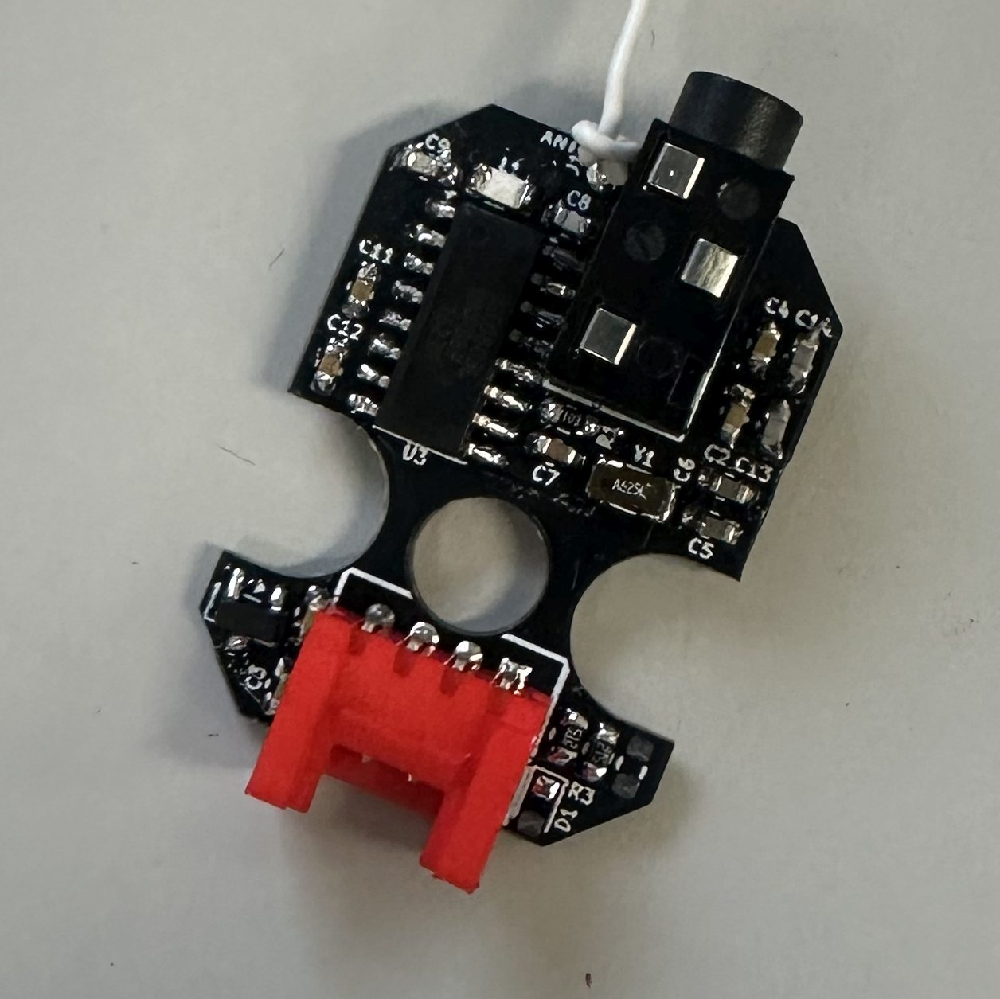

# FM Transmitter Unit

FMラジオ用のトランスミッタ（ステレオ）です。
I2Cで送信周波数などを設定できます。
送信する音声信号は、3.5mmステレオジャックから与えてください。

※電波出力が弱いため（微弱無線機）、到達距離は数m程度です。受信側のアンテナを工夫することである程度到達距離を伸ばすことは可能です。

電波法上の微弱無線機の規格を満たしていることは確認済みで、測定データはMeasure/に提示してあります。
アンテナを変更したり、送信出力を大きくすると、電波法上の基準を超えて違法となる場合がありますので、ご注意ください。

## 使い方

Library/ 以下に、ArduinoIDEとPlatformIOで利用できるライブラリがありますので、活用してください。
それぞれの使い方は、Library/README.mdに記載してあります。

## Author

Junichi Akita (@akita11) / akita@ifdl.jp
